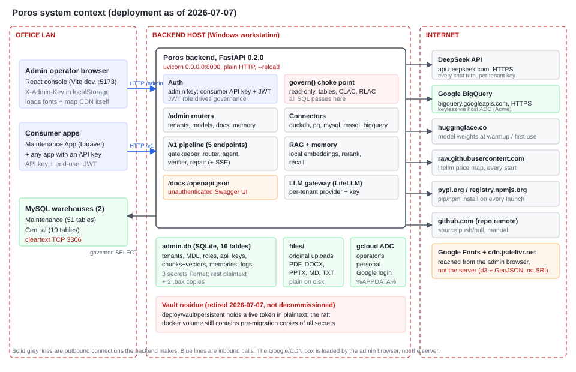
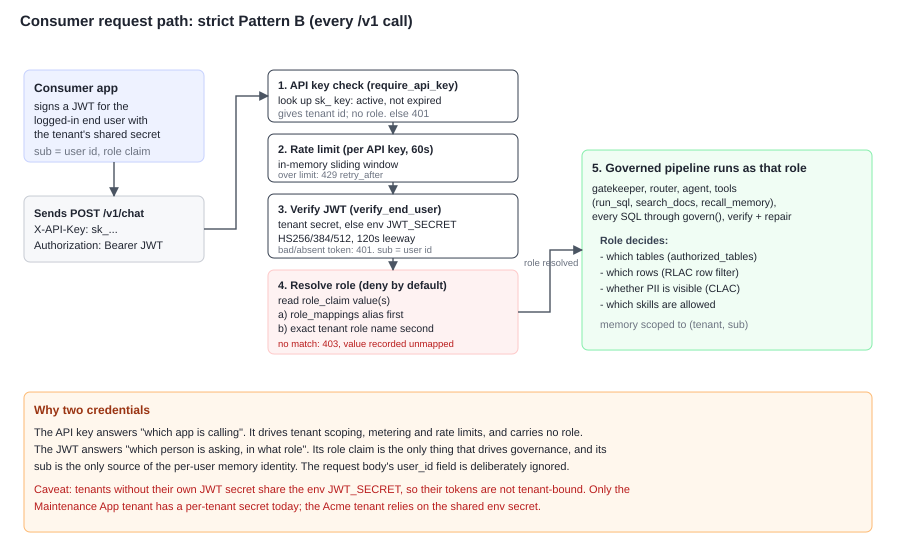
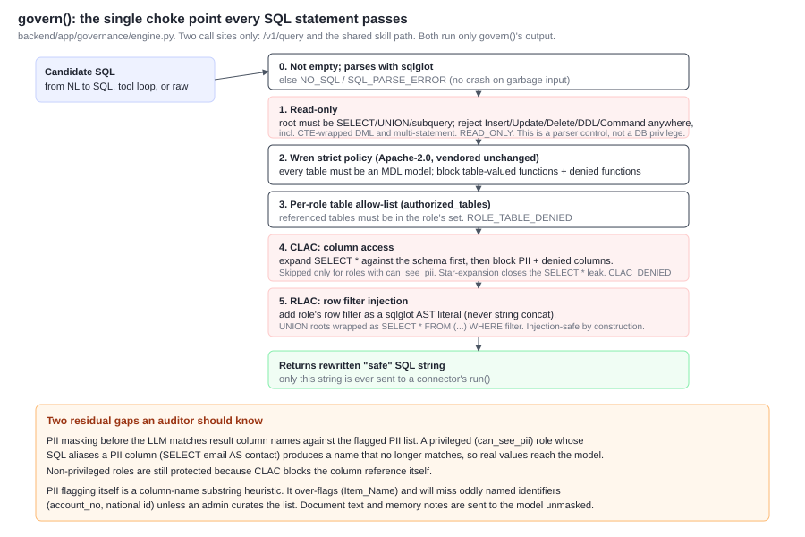
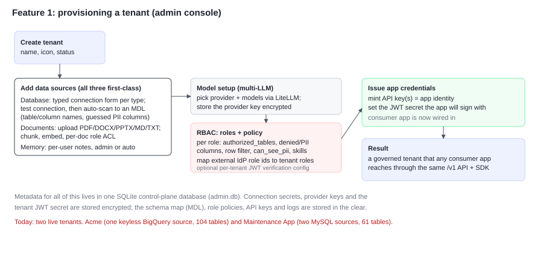
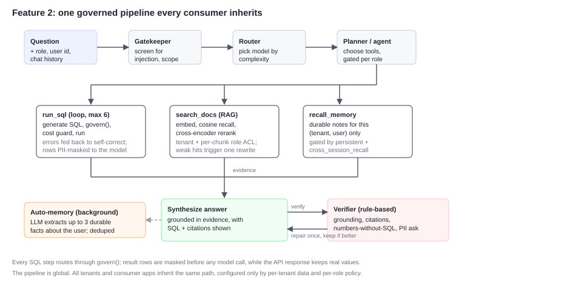

# Poros — technical architecture

Governed analytics and RAG control plane. Internal codename TenantOS. Application version 0.2.0.

This is the repository-canonical version of the architecture document. A formatted PDF built from the
same content and diagrams lives at [Poros-Architecture.pdf](Poros-Architecture.pdf); the vector diagrams
are in [diagrams/](diagrams/). Every claim here was checked against the source and the live control-plane
database rather than written from memory, and the security section reports the deployment as it actually
runs as of 7 July 2026, including dev defaults that are still in place.

## Contents

1. [What Poros is](#1-what-poros-is)
2. [System context and trust boundaries](#2-system-context-and-trust-boundaries)
3. [How a request is served (Pattern B)](#3-how-a-request-is-served-pattern-b)
4. [The governance choke point](#4-the-governance-choke-point)
5. [Feature maps](#5-feature-maps)
6. [Data inventory](#6-data-inventory)
7. [External system connections](#7-external-system-connections)
8. [Secrets handling](#8-secrets-handling)
9. [Security posture](#9-security-posture)
10. [Deployment and operations](#10-deployment-and-operations)
11. [Appendix: endpoints, stack, tests](#11-appendix)

## 1. What Poros is

Poros is a multi-tenant control plane. One team provisions governed analytics and document search for
several tenants, and consumer applications reach it through a single versioned API using an API key and a
per-user token. The product name shown to users is Poros; the codename TenantOS survives in code comments
and in a few lowercase infrastructure identifiers that live secret references depend on.

The design rests on one rule: numbers only ever come from validated SQL, access is scoped per tenant and
per role, and every consumer reaches the data through the same governed API. A tenant is defined by three
data sources that are all treated as first class, a choice of language models, and a set of roles. The
three data sources are a database, a set of documents, and a per-user memory. A consumer application does
not build its own analytics or its own access rules. It sends a question and a token, and Poros decides
what that person in that role is allowed to see and answers from it.

Two tenants run today. Acme connects one BigQuery dataset (104 tables of marketplace order data) with
keyless authentication. The Maintenance App connects two MySQL warehouses (61 tables covering assets and
maintenance work). Both tenants use DeepSeek as their language model. A demo tenant with a local DuckDB
sample exists only in seed code and is not present in the live database.

The backend is a FastAPI service backed by a single SQLite database that holds all control-plane metadata.
The admin console is a React application. The codebase is organized around a governance module every query
must pass through, a set of database connectors, a language-model gateway, a retrieval and memory layer,
and an agent that ties them together.

## 2. System context and trust boundaries

The service runs on a single Windows workstation and listens on all interfaces on port 8000 over plain
HTTP. Three groups of actors reach it from the office LAN: the admin operator through the React console,
consumer applications through the versioned API, and the tenant databases it queries. Outbound, it talks
to the language-model provider, to Google BigQuery, and to a handful of internet hosts for model weights,
package installs, and a price catalog.

Three boundary facts matter for a security review. First, there is no transport encryption anywhere in the
current run: the admin key, the consumer API keys, the end-user tokens, and the database credentials all
cross the LAN in the clear. Second, the interactive API documentation at `/docs`, `/redoc`, and
`/openapi.json` is served without authentication, so anyone on the LAN can read a full map of every
endpoint. Third, some outbound calls originate not from the server but from the admin operator's browser,
which loads fonts from Google and, when a chat answer draws the Indonesia map, pulls a charting library and
map data from a public CDN into the same page that holds the admin key.

## 3. How a request is served (Pattern B)

Every call to the consumer API carries two credentials, and the code calls this arrangement strict Pattern
B. The API key identifies the calling application. It resolves the tenant, drives metering and rate
limiting, and carries no role. The end-user token, a JSON Web Token the consumer application signs for its
logged-in user, identifies the person and their role. The token's role claim is the only thing that drives
governance, and its subject claim is the only source of the per-user memory identity. The request body also
has a user id field, but the code ignores it on purpose, because trusting it would break memory isolation
between users.

Role resolution is deny by default. The configured role claim can be a string or a list. For each value,
Poros first looks for a mapping the admin has set up (for example the external identity "SPV-01" aliased to
a tenant role), and only then tries an exact match against a tenant role name. A mapping is authoritative:
if an admin mapped a value to a role that was later deleted, that value is denied rather than falling
through to a name match, which closes a privilege-escalation path. Values that resolve to nothing are
recorded so the admin can see and map them later. A missing or invalid token returns 401; an unresolvable
role returns 403.

Token verification uses the tenant's own JSON Web Token configuration when it has one: an encrypted signing
secret, the accepted algorithms, and optional issuer and audience. When a tenant has no such configuration
it falls back to a server-wide secret from the environment. The default algorithms are symmetric (HMAC), so
any party that can verify a token can also mint one. That is why a shared fallback secret matters, and it
is covered in section 9.

## 4. The governance choke point

All SQL, whether a consumer sent it raw or the agent generated it, passes through one function before any
connector runs it. That function, `govern()`, has exactly two call sites in the codebase, and the only two
places that execute tenant SQL both run the string it returns. That is what makes the choke-point claim
real rather than aspirational. The checks run in a fixed order, and each has its own error code.

Read-only enforcement is worth calling out because it does not depend on the database account. The
connectors for Postgres, MySQL, SQL Server, and BigQuery run whatever SQL they receive on an ordinary
read-write session; only the DuckDB connector opens its file read-only. The barrier against writes is the
parser check in `govern()`, which requires the statement's root to be a select or set operation and rejects
any insert, update, delete, or schema-changing node anywhere in the tree, including the case where writes
hide inside a common table expression. An adversarial test suite of 26 cases exercises this along with
star-projection leaks, union and subquery smuggling, quoting tricks, comments, and injection through
row-filter values. That suite is what found the original gap where a non-select statement could reach a
Postgres or MySQL tenant.

Column and row access are the parts a role controls. Column access, called CLAC in the code, expands
`SELECT *` against the schema before it checks anything, so a star projection cannot smuggle a restricted
column past the check. It then blocks flagged PII columns and any columns the role denies, and it is
skipped only for roles marked as allowed to see PII. Row access, called RLAC, adds the role's row filter as
a parsed literal in the query tree rather than by string concatenation, which is why a hostile filter value
cannot turn into SQL. For union queries, which have no single where clause, the whole statement is wrapped
so the filter provably applies to the combined result.

## 5. Feature maps

The product brief names five features. Each is described below with the flow that implements it. Features 3
through 5 reuse the request path and pipeline already shown.

### 5.1 Tenant creation

Provisioning a tenant is an admin-console workflow. The admin creates the tenant, attaches the three data
sources, chooses the models, defines the roles, and issues the app credentials. Database sources are added
through a typed form per database type; the form tests the connection and then scans the schema into a
model definition (table and column names, with PII columns guessed from column-name patterns). Document
sources take file uploads that are chunked, embedded, and given a per-document role access list. Memory is
a per-user store that can be written by an admin or by the system itself.

### 5.2 RAG, agent, and skills

This is the pipeline every consumer inherits. There is one global path, not a per-tenant one; tenants
differ only by their data and their role policy. A question arrives with its role, user id, and recent chat
history. A gatekeeper screens it, a router picks a model by complexity, and an agent chooses tools. The
tools are gated per role: running SQL, searching documents, and recalling memory. Running SQL is a short
loop that generates a statement, governs it, checks its estimated cost, runs it, and feeds any error back
to correct itself, up to six turns. Document search embeds the query, recalls candidates by vector
similarity, and reranks them, enforcing tenant and per-chunk role access. A rule-based verifier then checks
the answer for grounding and citations and can send it back once for a single repair.

### 5.3 Monitoring

Every governed call writes a metering row: tenant, API key, role, action, row count, status, model, token
counts, and cost. The admin console reads these back as a cross-tenant rollup and per-tenant usage, and
renders request, token, and cost charts. Budgets can be set per tenant, but there is no hard stop today:
exceeding a budget does not block a request, and the only wired effect is a model downgrade that cannot
currently fire. The metering rows also store the API key value in the clear, which is noted in the data
inventory.

### 5.4 Consumer chatbot

The chatbot is the reference consumer. It shows the same governed answer a real consumer app would receive:
the natural-language reply, the SQL that produced any numbers, the document citations, and the reasoning
trace. In the admin console the chatbot also keeps chat sessions per tenant in the browser's local storage
(up to twelve sessions of thirty messages), so a refresh does not lose history. Those sessions hold full
question and answer text, including governed results, unencrypted in the browser.

### 5.5 API and SDK

The consumer surface is versioned under `/v1` and documented by the automatically generated OpenAPI schema.
Two thin SDK clients, one JavaScript and one Python, wrap the same endpoints. There are five consumer
endpoints in total; they are listed in the appendix. The admin surface is unversioned and is not part of
the consumer contract.

## 6. Data inventory

Almost everything Poros stores lives in one SQLite file, `admin.db`, on the backend host. Three fields in
it are encrypted; the rest is plaintext. Original uploaded documents sit as ordinary files on disk. A few
sensitive artifacts live outside the app entirely (the operator's Google credential, browser storage, and
Vault residue).

| Store | Location | Contents | Sensitivity | Protection |
|---|---|---|---|---|
| datasources.conn | admin.db | Full connection configs incl. MySQL host, user, password | High | Fernet `enc:` field encryption |
| llm_providers.api_key | admin.db | Per-tenant DeepSeek API keys | High | Fernet `enc:` field encryption |
| tenant_config (jwt).secret | admin.db | Per-tenant token signing secret | High | Fernet `enc:` field encryption |
| datasources.mdl | admin.db | Scanned schema of every customer DB: table/column names, guessed PII map | High | Plaintext JSON |
| api_keys | admin.db | Consumer API keys (`sk_` + 128-bit random), tenant, limits, expiry | High | Plaintext, not hashed |
| roles / policies | admin.db | Per-role rules: authorized tables, denied/PII columns, row filters, skills | Medium | Plaintext |
| role_mappings, unmapped_roles | admin.db | External identity aliases and recorded unresolved role values | Medium | Plaintext |
| doc_chunks | admin.db | Full text of every uploaded document, its vector, per-chunk role ACL | High | Plaintext |
| memories | admin.db | Per-(tenant, user) durable notes about end users, some model-written | High | Plaintext; isolation by query only |
| audit_log | admin.db | Raw question text, each governed SQL, answer text (2000 chars), captured memory | High | Plaintext; PII masking does not apply to logs |
| usage_log | admin.db | Per-request metering, plus the consumer API key value copied into each row | Medium-high | Plaintext |
| Uploaded document files | files/ on disk | Byte-exact original PDF/DOCX/PPTX/MD/TXT uploads | High | Plain files; NTFS permissions only |
| admin.db backups (2) | backend/app/ | Full pre-migration snapshots beside the live DB | High | None; one holds all secrets under the same key |
| gcloud ADC credential | %APPDATA% on host | Operator's personal Google login; the BigQuery identity for Acme | High | Windows profile permissions only |
| Browser local storage | Admin browser | Admin key (plaintext, no expiry), chat sessions, theme | High | None |
| Vault raft volume + init file | deploy/vault/persistent | Pre-migration copies of all secrets; unseal key + root token in cleartext | High | Vault seal, but unseal material sits next to it |

Two data-residency facts follow. The complete schema of three customer databases (table names, column
names, and the PII map) is stored in plaintext, which is useful reconnaissance even without the
credentials. And the three encrypted fields are the only application-level confidentiality control;
everything else depends on host and file-system access control.

## 7. External system connections

This is the connection list an information security review needs, covering both the flows the server makes
and the ones the admin browser makes. Where a connection is possible in code but not configured today, it
is marked dormant.

| Peer | Direction | Protocol | Auth | Data | Trigger |
|---|---|---|---|---|---|
| Consumer apps on the LAN | Inbound | HTTP (no TLS), :8000 | API key + end-user token | Questions, raw SQL, history in; answers, files out | Every consumer call |
| Admin console (browser) | Inbound | HTTP (no TLS), :8000 | Shared admin key | Tenant config, DB credentials in; API key values out | Every admin action |
| Anyone on the LAN | Inbound | HTTP, unauthenticated | None | Full OpenAPI schema, Swagger UI, health | Any request to /docs, /openapi.json, /health |
| DeepSeek API | Outbound | HTTPS via LiteLLM | Per-tenant key, decrypted at call | Question, schema catalog, masked result rows, doc excerpts, memory | Every chat turn |
| Google BigQuery | Outbound | HTTPS | Keyless via host ADC, optional SA impersonation | Governed SELECT and dry-run; rows back | Acme queries, scans |
| Google IAM / STS | Outbound | HTTPS | Base ADC or workload identity | Token exchange for an impersonated SA | Only if impersonation configured |
| MySQL warehouses (2) | Outbound | MySQL over TCP 3306, no TLS args | User + password (encrypted at rest) | Governed SELECT and scan; rows back | Maintenance App queries |
| huggingface.co | Outbound | HTTPS | None | Model id out; embedder + reranker weights back | Warmup at start, or first use |
| raw.githubusercontent.com | Outbound | HTTPS | None | LiteLLM price catalog | Every backend start (import time) |
| pypi.org, registry.npmjs.org | Outbound | HTTPS | None | Package installs (backend unpinned, frontend pinned) | Every launch |
| Google Fonts | Outbound (admin browser) | HTTPS | None | Fonts and icon glyphs | Every console page load |
| cdn.jsdelivr.net | Outbound (admin browser) | HTTPS, no integrity pinning | None | d3 (executable) + Indonesia GeoJSON from a mutable branch | When a chat answer draws the map |
| github.com (repo remote) | Outbound | HTTPS (git) | Operator's GitHub credentials | Full source on push (DBs/secrets excluded) | Manual push and pull |
| Other providers / arbitrary api_base | Outbound | HTTPS/HTTP | Stored provider key | Same prompt payload, plus the key, to the configured host | Dormant (no egress allow-list) |
| Local codex CLI subprocess | Outbound | Subprocess; CLI talks to OpenAI | Device login cached on host | Whole prompt flattened to text | Dormant (no tenant configured) |
| HashiCorp Vault / OpenBao | Outbound | HTTP(S), stdlib client | Static token or AppRole | Secret values on read and write | Dormant (migrated to Fernet; residue remains) |
| Docker Hub | Outbound | HTTPS | Anonymous | Vault container image | Dormant (legacy Vault launcher) |

One outbound call is easy to miss on an egress-restricted network. LiteLLM fetches its model-price catalog
from GitHub at import time on every backend start. Setting `LITELLM_LOCAL_MODEL_COST_MAP=true` uses the
bundled copy instead. No usage telemetry is sent by the library in the installed version; the price-map
fetch is the only phone-home.

## 8. Secrets handling

Poros has a secrets seam with two backends selected by an environment variable: a Fernet default and a
Vault backend. The deployment migrated back to Fernet on 7 July 2026, so Vault is not used at runtime
today, and all eight stored secrets carry the Fernet `enc:` prefix. The decrypt path still reads all
formats (Fernet, the reversible obfuscation fallback, Vault references, and legacy plaintext), so switching
backends or rolling back never breaks a stored row.

Three secret types flow through this seam: the database connection configs, the provider API keys, and the
per-tenant token signing secrets. Consumer API keys do not; they are stored in the clear. Encryption uses
Fernet (AES-128 in CBC with an HMAC), with the key derived as a plain SHA-256 of a passphrase from the
environment. There is no salt, no key-derivation stretching, and no key-rotation path, so changing the
passphrase would orphan every existing encrypted row.

The important current-state fact is the passphrase. The launcher does not set it, so the key derives from a
constant string committed in the source. Anyone who obtains the database file can therefore decrypt every
encrypted secret, because the key is public in the repository. This is not a design flaw in the seam (a
real passphrase set in the environment fixes it) but it is the state the deployment runs in. The fail-hard
guard that would refuse these dev defaults only fires when the environment is explicitly marked as
production, which the launcher does not do.

Rotation and deletion paths are careful in one respect: they encrypt the replacement before purging the
old value, so a failure keeps the working secret, and they purge the backing store on delete. The gap is
cleanup: two full database backups sit unencrypted beside the live file, and the retired Vault volume plus
its cleartext unseal material were never destroyed, so pre-migration copies of every secret may still be
recoverable on the host.

## 9. Security posture

This section is written for the information security review. It separates what the design does well from
what the current deployment leaves open, and it does not soften the latter.

### Controls that hold up

The governance choke point is real: `govern()` has two call sites, both execution paths run only its
output, and an adversarial test suite guards the read-only, star-expansion, and injection behavior. Row
filters are added as parsed literals, not string concatenation, so filter values cannot become SQL. The
two-credential model keeps app identity and user role separate, with no path for an API key to carry a
role. Broken role mappings deny rather than fall through. The per-user memory identity comes only from the
verified token subject, never the request body. Result rows are masked for flagged PII columns before any
model call while the API response keeps real values. Tenant isolation is enforced on every retrieval and
memory query by a tenant filter. The admin key comparison is constant-time.

### Findings from the current deployment configuration

Properties of how the service is launched today, not of the code's capabilities. Each has a straightforward
remediation lever.

| # | Finding | Why it matters | Lever |
|---|---|---|---|
| D1 | Plain HTTP on all interfaces | Admin key, API keys, tokens, DB credentials cross the LAN in the clear | Terminate TLS in front; bind to a specific interface |
| D2 | Admin key is the published dev default | The whole control plane, incl. minting user tokens, sits behind one shared LAN-reachable string | Set a real admin key; set the production env flag |
| D3 | Encryption key is a public constant | Anyone with the DB file decrypts all DB credentials and provider keys | Set the passphrase in the environment; re-encrypt |
| D4 | Fallback token secret committed to the repo | Anyone with repo access can forge user tokens for any tenant lacking its own secret (Acme is in this state) | Set a strong secret; give each tenant its own |
| D5 | Unauthenticated API documentation | A full endpoint map is readable by anyone on the LAN | Gate or disable /docs, /redoc, /openapi.json |
| D6 | Consumer API keys stored plaintext | DB/backup theft yields every live consumer credential; keys also in each metering row | Hash keys at rest; stop logging the value |
| D7 | Vault decommission incomplete | A live token and pre-migration secret copies remain recoverable on the host | Revoke the token; destroy the volume and backups |
| D8 | Wide-open CORS and dev servers | Any origin may call the API; launcher runs auto-reload and the Vite dev server | Restrict origins; use production builds |

### Findings in the design

These persist even with a hardened configuration.

| # | Finding | Detail |
|---|---|---|
| A1 | PII masking bypassable by aliasing (privileged roles only) | Masking matches result column names against the PII list. A `can_see_pii` role writing `SELECT email AS contact` produces a name that no longer matches, so real values reach the model. Non-privileged roles are still protected because column access blocks the reference itself. |
| A2 | Document text and memory notes sent to the model unmasked | Only SQL result columns are masked. PII inside a document or a captured memory goes to the provider as written. Auto-capture is told not to store identifiers, but that is a prompt instruction, not an enforced check. |
| A3 | Every prompt is sent to the provider, including blocked ones | The gatekeeper sends the raw message to the model to classify it before the block decision, so a refused message has already left the boundary. |
| A4 | Admin actions are not audited | Key minting/revocation, role/policy edits, JWT-config changes, credential rotation, and tenant deletion leave no trail, and the shared admin key would make attribution impossible anyway. |
| A5 | PII detection is a name heuristic | Columns are flagged by substring match on the name. It over-flags (Item_Name) and misses oddly named identifiers unless an admin curates the list. |
| A6 | Budgets are advisory | Exceeding a budget does not stop a request; the only wired effect is a model downgrade that cannot currently fire. The spend figure sums all-time cost, not the period. |
| A7 | No egress allow-list for model providers | An admin can point a provider at any host, which would send both the prompt payload and the stored key there. |
| A8 | Read-only is a parser control, not a privilege | The database accounts are read-write; only the parser check stops writes. Read-only DB accounts would add defense in depth. |

The honest summary is that the governance core (what a given role may query and see) is well constructed
and tested, while the surrounding deployment runs on development defaults that would each need to change
before this faces anything but a trusted internal network. None of the deployment findings require code
changes; they are configuration and operational cleanup.

## 10. Deployment and operations

The service is started by a batch launcher that installs dependencies, seeds a demo tenant only if the
database is absent, and runs the API on all interfaces on port 8000 with auto-reload. The console is served
by the Vite development server on localhost. Since the move off Vault, the only launcher needed is the
plain backend one; the Vault launchers remain in the repo but are legacy. Because the launcher reinstalls
dependencies on every start and the backend requirements are largely unpinned, package versions can drift
between restarts. The frontend is pinned by its lock file.

Model weights for the embedder and reranker are pulled from HuggingFace at warmup unless already cached,
and there is no offline flag set, so an egress-blocked host silently falls back to a weak local embedder
rather than failing loudly. For an air-gapped deployment, the models should be pre-baked and the offline
flags set, the LiteLLM price map pinned to its local copy, and the console's fonts and map assets
self-hosted.

## 11. Appendix

### Consumer endpoints (all require API key + verified token)

| Method and path | Purpose |
|---|---|
| `POST /v1/query` | Run raw SQL through govern() |
| `POST /v1/chat` | Governed agent pipeline over database, documents, and memory |
| `POST /v1/chat_stream` | Same pipeline, streamed as server-sent events |
| `POST /v1/retrieve` | Document retrieval with role access and citations |
| `GET /v1/documents/{id}/file` | Download an original document, gated by tenant match and per-doc access |

The admin surface is unversioned and sits behind the shared admin key. It covers tenant CRUD, cross-tenant
monitoring, datasource and connection management, roles and role mappings, API keys, model providers and
budgets, documents, memory, and a development helper that mints user tokens. The admin document download and
archive routes are scoped only by document id, so the single admin key implicitly grants cross-tenant
document access.

### Technology stack

Backend: Python with FastAPI and uvicorn, SQLite for all metadata, sqlglot for SQL parsing, LiteLLM for the
model gateway, sentence-transformers and a cross-encoder for embeddings and reranking, the cryptography
library for Fernet, and PyJWT for tokens. Database drivers: the BigQuery client, psycopg2 for Postgres,
PyMySQL for MySQL, and pyodbc for SQL Server (optional, not installed by default). Document parsing: pypdf,
python-docx, python-pptx. Frontend: React with Vite and ECharts. Governance policy is vendored unchanged
from the Apache-2.0 Wren project; the AGPL Wren Classic is deliberately not used.

### Test coverage

The suite has 104 tests: 28 end-to-end smoke, 26 adversarial governance, 17 secrets-backend, 6 BigQuery
auth, 4 ingest-format, 7 agent-loop, 10 memory, and 6 gatekeeper tests. The adversarial governance suite
is the one that most directly backs the security claims in section 4.
